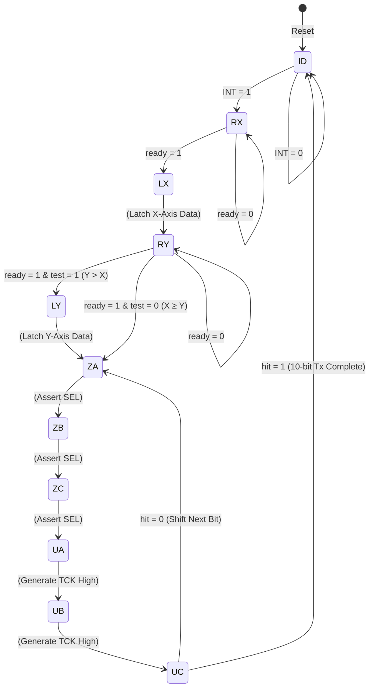
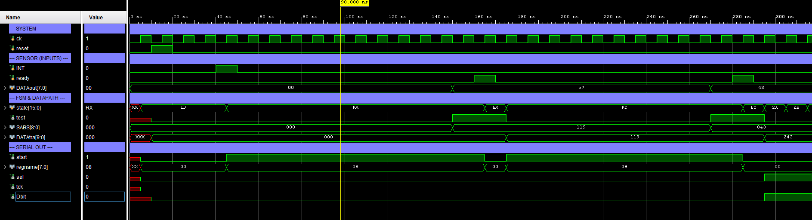
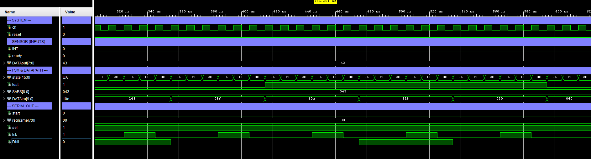

# 🏎️ Hardware-Accelerated Automotive Crash Detector & DAQ System


## 📌 Project Overview
This repository contains the RTL design, synthesis logic, and behavioral verification of a **Safety-Critical Airbag Control Unit (ACU)** combined with a **Data Acquisition (DAQ) module**. 

Designed for high-reliability automotive environments, the system interfaces with a multi-axis MEMS accelerometer, filters out mechanical noise (e.g., road potholes), computes absolute G-forces, and serializes the critical impact data via a custom communication protocol.

## 🏗️ System Architecture

To ensure deterministic execution and zero-latency routing, the design strictly separates the **Control Unit** from the **Datapath**.


* **Control Unit (Moore FSM):** Manages the asynchronous handshaking protocol (`ready`/`INT`) with the external sensor. It evaluates conditions and schedules the serial transmission without generating combinational loops.
* **Datapath Elements:**
  * **Sign-Magnitude Converter:** Purely combinational logic that natively handles 2's complement 8-bit data, converting it to absolute values to detect both frontal (positive G) and rear (negative G) impacts.
  * **Magnitude Comparator:** Evaluates the dominant impact axis (X vs. Y) in a single clock cycle.
  * **Custom Shift Register:** Packages the highest magnitude data and streams it serially using a synthesized transmission clock (`tck`).

## 🧠 Finite State Machine (FSM) Design

The core logic is governed by a **Moore FSM**, ensuring that outputs depend solely on the current state, preventing glitch propagation to the deployment mechanisms.



## 📊 Behavioral Verification & Edge-Case Testing

The RTL was rigorously verified using the **Xilinx Vivado Simulator**. The testbench (`tb_crash_detector.v`) injects targeted stimuli to validate the glitch-filtering capabilities and protocol adherence.

### 1. Acquisition & Decision Logic
The FSM correctly handles the interrupt (`INT`), fetches data for both axes, and natively computes the absolute maximum value. The waveform below demonstrates the FSM resolving a severe negative acceleration (-25G) versus a positive one (+67G).



### 2. Custom Serial Transmission
Following the decision logic, the system synthesizes a localized transmission clock (`tck`) and shifts out the 10-bit payload (`Dbit`) to the vehicle's black box/telemetry system.



### 📝 Testbench Execution Log

```text
--- SIMULATION STARTED ---
Testing Scenario 1: X-Axis impact dominant  (Input: X=-25, Y=+67) -> Result: Latched 67
Testing Scenario 2: X-Axis positive dominant (Input: X=+67, Y=-25) -> Result: Latched 67
Testing Scenario 3: Y-Axis impact dominant  (Input: X=+21, Y=-123) -> Result: Latched 123
--- SIMULATION FINISHED ---
```

## ⚙️ How to Run the Simulation
1. Clone the repository: `git clone https://github.com/YourUsername/FPGA-Crash-Detector.git`
2. Open **Xilinx Vivado** and create a new RTL project.
3. Add the files from the `src/` directory as **Design Sources**.
4. Add `tb_crash_detector.v` from the `sim/` directory as a **Simulation Source**.
5. Run **Behavioral Simulation**.
6. *Tip:* For optimal viewing, change the Radix of `DATAout` to *Signed Decimal* and the Radix of `state` to *ASCII*.

> **🎓 Project Origin & Enhancements:** Originally conceived as part of an advanced *Digital Systems Design* university coursework (achieved maximum honors), the core RTL logic has been significantly refactored, extended, and rigorously verified in this repository to align with industry-standard documentation and simulation practices.

---
*Designed by Daniele Loche - 2026*
